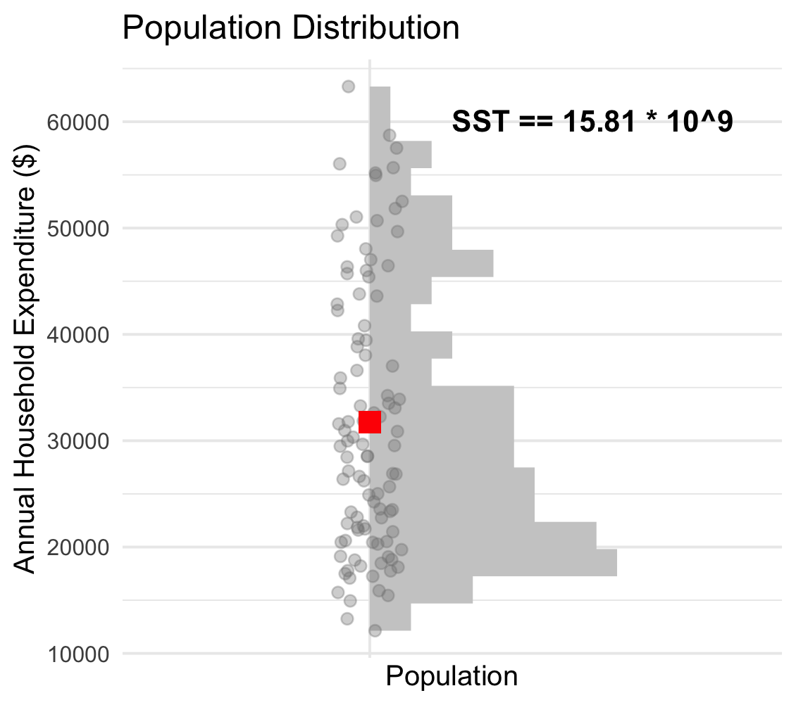
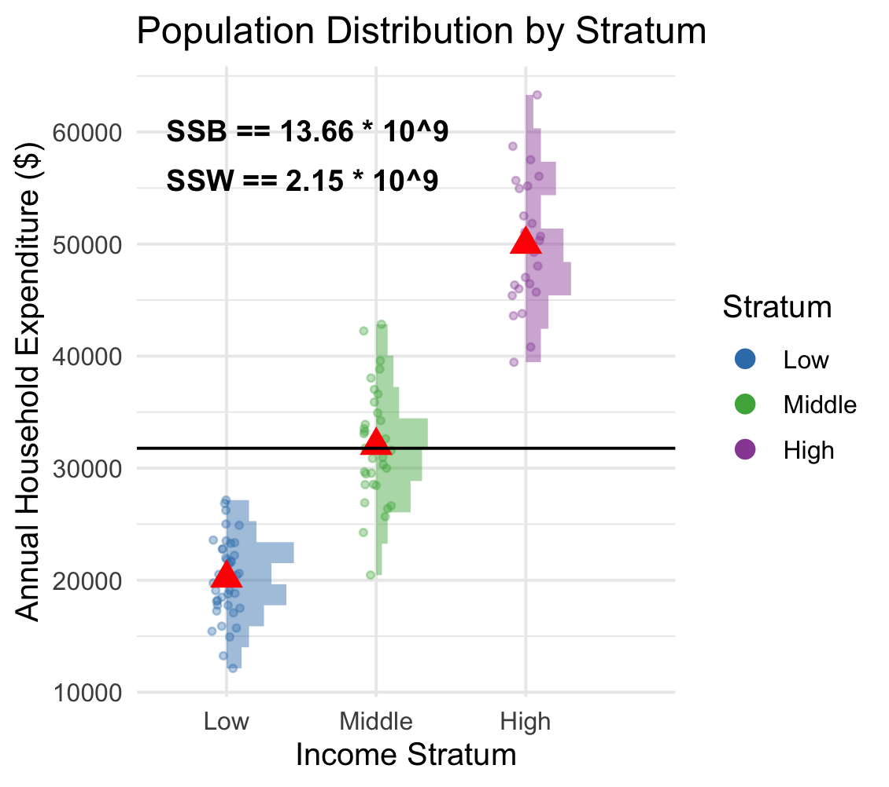

```{r setup, include=FALSE}
knitr::opts_chunk$set(echo = TRUE)
library(ggplot2)
knitr::opts_chunk$set(fig.align = "center")

set.seed(123)
# Define the population size in each income group
income_group <- c(
  rep("Low", 40),
  rep("Middle", 35),
  rep("High", 25)
)
# Simulate annual expenditure for each household
population <- data.frame(
  household_id = 1:1000,
  income_group = factor(
    income_group,
    levels = c("Low", "Middle", "High")
  ),
  expenditure = c(
    rnorm(40, mean = 20000, sd = 4000),
    rnorm(35, mean = 32000, sd = 5000),
    rnorm(25, mean = 48000, sd = 7000)
  )
)
```

# Lecture 1 {.unnumbered}

[Readings]{style="color: orange;"}: Sections 3.4-3.5, 3.7, 3.6*

[Due Dates]{style="color: orange;"}: Homework from Week 2 is due on October 13. 

[Practice 3]{style="color: orange;"}: Hand-solve problems on stratification allocation

[Feedback]{style="color: orange;"}: Week 1 Homework is graded.

- Most common mistake was in identifying the sampling frame and observational unit.
- Make sure the pages are matched to the questions in the outline while submitting on Gradescope.

## Outline

- [Defining Strata]{style="color: orange;"}
- [Allocation]{style="color: orange;"}
  - Equal allocation
  - Proportional allocation
  - Optimal allocation
  - Neyman allocation
- [Sample Size Estimation]{style="color: orange;"}

---

## Design Choices of Stratified Sampling

For SRS, our design choice was $n$, the [sample size]{style="color: orange;"}.
	
<br>
	
For Stratified Sampling, our design choices are

- What are the strata?
- How many observations do we sample total? ( $n$ )
- How many observations do we sample from each stratum? ( $n_h$ )
	
<br>


## Defining Strata

Idea: Population Analysis of Variance (ANOVA). Partition Total variation ($SST$) into variation *between* strata ($SSB$) and variation *within* strata ($SSW$). 


\begin{align*}
SST &= \sum_{h=1}^H \sum_{j=1}^{N_h}(y_{hj}-\bar{y}_\mathcal{U})^2 = (N-1)S^2 \quad \text{Total Variation}\\
SSB &= \sum_{h=1}^H \sum_{j=1}^{N_h}(\bar{y}_{h\mathcal{U}}-\bar{y}_\mathcal{U})^2 = \sum_{h=1}^HN_h(\bar{y}_{h\mathcal{U}}-\bar{y}_\mathcal{U})^2 \quad \text{Variation in Strata Means} \\
SSW &= \sum_{h=1}^H \sum_{j=1}^{N_h}(y_{hj}-\bar{y}_{h\mathcal{U}})^2 = \sum_{h=1}^H(N_h-1)S_h^2 \quad \text{Sum of Within Strata Variations} \\

SST &= SSB + SSW
\end{align*}

<br>

Since $SST$ is fixed, we want to stratify so that $SSB$ is big and $SSW$ is small.

---

## Example (Sum of Squares from an ANOVA Table)

Suppose we are interested in finding the average household expenditure from a population of 100 households. Earlier studies showed the following characteristics. 

```{r, echo=FALSE, show = FALSE}
set.seed(123)

# Define the population size in each income group
income_group <- c(
  rep("Low", 40),
  rep("Middle", 35),
  rep("High", 25)
)

# Simulate annual expenditure for each household
population <- data.frame(
  household_id = 1:100,
  income_group = factor(
    income_group,
    levels = c("Low", "Middle", "High")
  ),
  expenditure = c(
    rnorm(40, mean = 20000, sd = 4000),
    rnorm(35, mean = 32000, sd = 5000),
    rnorm(25, mean = 48000, sd = 7000)
  )
)

# Calculate the population mean
population_mean <- mean(population$expenditure)

# Calculate the mean for each stratum
strata_means <- aggregate(
  expenditure ~ income_group,
  data = population,
  FUN = mean
)
```

<br>

```{r, echo = TRUE}
anova <- aov(expenditure ~ income_group, data = population)
summary(anova)
```
<br>

$SSB$ ($13.6 \times 10^9$) is big and $SSW$ ($2.1 \times 10^9$) is small.

## Example (Visualization of Sum of Squares)


{width="45%"}
{width="45%"}


## Allocating Observations to Strata
	
Now, let us assume that strata are known. We'll discuss methods of allocating observations to strata.

- Equal Allocation : [Equal]{style="color:orange;"} size from each stratum
- Proportional Allocation : size [proportional]{style="color:orange;"} to population size from each stratum
- Optimal Allocation : Allocate size that [minimizes cost]{style="color:orange;"} when costs are given 
- Neymann Allocation : [Special case of optimal allocation]{style="color:orange;"} when costs are same for gathering information in any strata

---

## Equal Allocation

Take a sample of the same size from each stratum, i.e. $n_h$ are the same for all strata $h$.

$$n_h=\frac{n}{H} \qquad \text{round up}$$	

<br>

Consider using when

- Variances in each stratum approximately equal ( $S_1^2\approx S_2^2\approx\cdots\approx S_H^2$ )
- Plan to use a more complicated analysis (e.g., ANOVA) where balanced data are nice

---

## Proportional Allocation

Number of sampled units in each stratum is proportional to the size of the stratum.

$$n_h=\frac{N_h}{N}(n)$$

The formula comes from defining $\frac{n_h}{N_h}=\frac{n}{N}$ and solving for $n_h$.

- Use when you are taking a stratified sample in order to ensure the sample reflects the population with respect to the stratification variable.
- Inclusion probability $\pi_{hj}=\frac{n_h}{N_h}=\frac{n}{N}$ is the same for all strata.
- Generally the best allocation when $S_h^2$ is about the same across all strata.

---

## Proportional Allocation - Example

*Example*: Population is 10,000 buildings. Stratify by number of floors: 1000 buildings with $>$ 10 floors, 9000 with $\leq$ 10 floors.

<br>

Draw a $10\%$ sample (1000 buildings). A proportional allocation would draw

$$\begin{align*}
\frac{n_\text{short}}{N_\text{short}}&=\frac{n_\text{tall}}{N_\text{tall}} = \frac{n}{N} = \frac{1000}{10000} \\
\\
	\frac{n_\text{short}}{9000}&=\frac{1000}{10000}\qquad \text{and} \qquad\frac{n_\text{tall}}{1000}=\frac{1000}{10000} \\
\end{align*}$$

$n_\text{short}=900$ and $n_\text{tall}=100$.

If this were equal allocation, we have 

$n_\text{short}= 1000/2 =  500$ and $n_\text{tall}=1000/2 = 500$

---

## Proportional Allocation

Each unit in the sample represents the same number of units in the population. Proportional allocation thus results in a *self-weighting* sample.	

$$\text{sample weight} \quad  w_{hj} = \frac{1}{\pi_{hj}} =  \frac{N_h}{n_h} = \frac{N}{n}$$

<br>

The sampling weights are all $\frac{N}{n}$, same as SRS, so will get the same point estimate as SRS. *However, because we are stratifying, SEs tend to be smaller* (especially when units within strata are homogeneous, units between strata are heterogeneous).

For example,

$$\hat{t}_{str} = \sum_{h=1}^{H} \sum_{j=1}^{n_h} w_{hj} y_{hj} = \sum_{h=1}^{H} \sum_{j=1}^{n_h} \frac{N}{n} y_{hj}$$

---

## Proportional Allocation

When the strata are large enough, the variance of $\bar{y}_\text{str}$ under proportional allocation is usually *at most* as large as the variance of the sample mean under SRS with the same number of observations. This is true no matter what the stratification scheme may be.
	
---

## Optimal Allocation

When $S_h^2$ vary greatly across strata, optimal allocation can result in smaller *costs* (in terms of money/number of samples, or variance).

<br>

Objective: gain the most information for the least cost. Define a cost function

$$C=c_0+\sum_{h=1}^H c_hn_h$$

where $c_0$ is overhead costs and $c_h$ is the cost of taking an observation in stratum $h$.

<br>

Want to allocate observations to strata to

- Minimize $V(\bar{y}_\text{str})$ for a given total cost $C$; or
- Minimize $C$ for a given $V(\bar{y}_\text{str})$

---

## Optimal Allocation

Optimal sample size of stratum $h$ is
$$n_h=\left(\frac{\frac{N_hS_h}{\sqrt{c_h}}}{\sum\limits_{l=1}^H\frac{N_lS_l}{\sqrt{c_l}}} \right)n$$	

<br>

Sample heavily from a stratum if

- Stratum accounts for a large part of the population (larger $N_h$)
- Variance within the stratum is large (larger $S_h$)
- Sampling within the stratum is inexpensive (smaller $c_h$)

---

## Optimal Allocation - Example

*Example*: Population is 10,000 buildings. 1000 tall buildings, 9000 short buildings. You want to count the *number of fire extinguishers on the top floor of the building*. You have $5000 for your survey. It costs $100 to measure a tall building but only $25 to measure a short building. Suppose the population standard deviation is 60 in the tall buildings group and 50 in the small buildings group. How many tall and short buildings should you sample?
	
$$\begin{align*}
n_h&=\left(\frac{\frac{N_hS_h}{\sqrt{c_h}}}{\sum_{l=1}^H\frac{N_lS_l}{\sqrt{c_l}}}\right)n \\
n_\text{tall} &= \left(\frac{\frac{1000\times 60}{\sqrt{\$100}}}{\frac{1000\times 60}{\sqrt{\$100}}+\frac{9000 \times 50}{\sqrt{\$25}}}\right)n= 0.0625(n) \\
n_\text{short} &= \left(\frac{\frac{9000\times 50}{\sqrt{\$25}}}{\frac{1000\times 60}{\sqrt{\$100}}+\frac{9000\times 50}{\sqrt{\$25}}}\right)n= 0.9375(n)
\end{align*}$$

---

## Optimal Allocation - Example

$n_\text{tall} = 0.0625(n)$ and $n_\text{short} = 0.9375(n)$

$$\begin{align*}
C&=\sum_{h=1}^H c_hn_h \\
\$5000&=\$100 n_\text{tall}+\$25 n_\text{short} \\	
\$5000&=\$100(0.0625)(n)+\$25(0.9375)(n) \\	
n &= 168.42
\end{align*}$$

<br>
	
And specifically $n_\text{tall}=0.0625(168.42)=10.526$ and $n_\text{short} = 0.9375(168.42)=157.894$.

<br>

In order to stay under budget, I would sample 10 tall buildings and 158 short buildings. (*If both 10.5 and 157.9 are rounded up, you go over budget.*)

---

## Optimal Allocation

If all variances and costs are equal, proportional allocation is the same as optimal allocation.

<br>

Optimal allocation will differ for each variable being measured, whereas proportional allocation depends only on the number of population units in each stratum.	


---

## Neyman Allocation

Neyman allocation is a form of optimal allocation used when the costs in the strata are approximately equal.

<br>

$$n_h=\left(\frac{N_hS_h}{\sum\limits_{l=1}^HN_lS_l} \right)n$$	

<br>

If the variances $S_h^2$ are specified correctly, Neyman allocation will give an estimator with smaller variance than proportional allocation.

---

## Neyman Allocation - Example

Building example. Now stand outside building for one hour, *count the number of people who enter the building*. Costs are the same for each building, but expect tall buildings to have higher variance. From a pilot study, you approximate $S_\text{tall}^2=1600$ and $S_\text{short}^2=900$. How should we allocate a sample of size $500$?
	
$$\begin{align*}
n_h&=\frac{N_hS_h}{\sum_{l=1}^HN_lS_l}n \\
n_\text{tall}&=\frac{1000\sqrt{1600}}{1000\sqrt{1600}+9000\sqrt{900}}(500) =64.52 \\ 
n_\text{short}&=\frac{9000\sqrt{900}}{1000\sqrt{1600}+9000\sqrt{900}}(500) =435.48 \\	
\end{align*}$$

<br>
	
So sample 65 tall buildings and 435 short buildings.

---

## Sample Size Estimation

We saw how to use the total cost of a survey to determine allocation and sample size. How about using a level of precision, like we did for SRS?

<br>

If we can ignore the finite population correction and the normal approximation is valid, *and* if we know the relative sample fractions per strata:

<br>

$$n=\frac{z_{\alpha/2}^2 \sum_{h=1}^H\frac{n}{n_h}\left(\frac{N_h}{N}\right)^2S_h^2}{e^2}$$

---

## Sample Size Example

Building example: 1000 tall buildings and 9000 short buildings, where we approximate $S^2_\text{tall}=1600$ and $S^2_\text{short}=900$ from a pilot study. Suppose we want to do proportional allocation. How many buildings do we need to sample to get a 95% confidence interval with margin of error 5?

$$\begin{align*}
n&=\frac{z_{\alpha/2}^2 \sum_{h=1}^H\frac{n}{n_h}\left(\frac{N_h}{N}\right)^2S_h^2}{e^2} \\
&=\frac{z_{\alpha/2}^2 \sum_{h=1}^H\left(\frac{N_h}{N}\right)S_h^2}{e^2} \\
&=\frac{1.96^2 \left(\frac{1000}{10000}1600 + \frac{9000}{10000}900 \right)}{5^2} \\
&= 149.05
\end{align*}$$

So sample 150 buildings. With proportional allocation, this is 15 tall and 135 short buildings.


# Lecture 2 {.unnumbered}

## Outline

- Introduction to Ratio Estimation
- Point Estimates
- Bias and MSE
- Variance of Estimators
- Sampling Weights

---

## Ratio Estimation - Introduction

We often have **auxiliary** information in surveys. This can be used to improve the precision of our estimates.

<br>

**[Ratio estimation]{style="color: orange;"}** (along with regression estimation -- next lecture) uses variables that are correlated with the variable of interest to improve the precision of estimates of population means, totals, and proportions.

---

## Auxiliary Variables

Two quantities must be measured on each sample unit:

- $x_i$ the **auxiliary variable** or **subsidiary variable**
- $y_i$ the outcome of interest

<br>

Ratio estimation takes advantage of the *correlation* of $x$ and $y$ in the population.

<br>
 
> The higher the correlation, the better the method works.

---

## Population Correlation Coefficient

$R$ is the **[Pearson correlation coefficient]{style="color: orange;"}** of $x$ and $y$ for the $N$ units in the population

$$R=\frac{\sum_{i=1}^N(x_i-\bar{x}_\mathcal{U})(y_i-\bar{y}_\mathcal{U})}{(N-1)S_xS_y}$$
where $S_x$ is the population standard deviation of the $x_i$, $S_y$ is the population standard deviation of the $y_i$.

---

## Ratio Estimation Setup

For ratio estimation

- Observe $y_i$ and $x_i$ for unit $i\in\mathcal{S}$
- AND know $\bar{x}_\mathcal{U}$ (or $t_x$) for the population
- Want to estimate $\bar{y}_\mathcal{U}$ (or $t_y$)
- $x$ and $y$ should be highly correlated, and *the line $y=Bx$ should pass through the origin*

<br>

For example, a lot of demographic information is known for the whole United States (collected during Census). If we take a sample to measure some other variable (e.g., who you'll vote for in the election, what new products you'd like to see a company adopt) you can measure the demographic variables in your sample and adjust your estimate based on the sample's overall representativeness of the population.

---

## Ratio $B$

Let $t_y=\sum\limits_{i=1}^N y_i$ and $t_x=\sum\limits_{i=1}^N x_i$. Define their **[ratio]{style="color: orange;"}** as $$B=\frac{t_y}{t_x}=\frac{\bar{y}_\mathcal{U}}{\bar{x}_\mathcal{U}}$$

Estimate $B$ using

$$\hat{B}=\frac{\bar{y}}{\bar{x}}=\frac{\hat{t}_y}{\hat{t}_x}$$

---

## Quantities

| In the population | In the sample
- | - | -
Mean of $y$ | $\bar{y}_\mathcal{U}$ (unknown; of interest) | $\bar{y}$
Mean of $x$ | $\bar{x}_\mathcal{U}$ (assume known) | $\bar{x}$ (may not $=\bar{x}_\mathcal{U}$)
Total of $y$ | $t_y$ (unknown; of interest) | $\hat{t}_y$
Total of $x$ | $t_x$ (assume known) | $\hat{t}_x$ (may not $=t_x$)
Ratio of $x$ and $y$ | $B=\frac{t_y}{t_x}=\frac{\bar{y}_\mathcal{U}}{\bar{x}_\mathcal{U}}$ | $\hat{B}=\frac{\hat{t}_y}{\hat{t}_x}=\frac{\bar{y}}{\bar{x}}$

---

## Ratio Estimation

Ratio estimates for the population total and population mean (assuming SRS) are

$$\begin{align*}
\hat{t}_{yr} &= \hat{B}t_x \\
& \\
\hat{\bar{y}}_r& = \hat{B} \bar{x}_\mathcal{U}
\end{align*}$$

---

## Why use ratio estimation?

- Want to estimate a ratio (e.g., average yield per acre) so $\frac{\bar{y}}{\bar{x}}$ has random numerator and random denominator
- Want to estimate a population total, but $N$ is unknown
- Increase the precision of estimated means and totals (smaller MSE)
- Adjust estimates from the sample so they reflect demographic totals
- Adjust for nonresponse

---

## Example - Oranges

The wholesale price paid for oranges in large shipments is based on the sugar content of the load. The exact sugar content cannot be determined prior to the purchase and extraction of the juice from the entire load; however, it can be estimated.

<br>

One method is to first estimate the mean sugar content per orange, $\bar{y}_\mathcal{U}$, and then multiply by the number of oranges $N$ in the load. To do this, we would take a sample of $n$ oranges, find $\bar{y}$ and then estimate $t_y$ by $N\bar{y}$.

<br>

But this is not feasible because we don't know $N$ and it would be too time-consuming to count all the oranges!

---

## Example - Oranges

Another approach -- we know that the sugar content of an orange $y$ is closely related to its weight $x$.

<br>

In our sample, we can measure $y_i$ (sugar content) and $x_i$ (weight) for each orange. It's much easier for us to measure the total weight $t_x$ of all the oranges, rather than $N$. Then

$$B=\frac{\bar{y}_\mathcal{U}}{\bar{x}_\mathcal{U}}=\frac{N\bar{y}_\mathcal{U}}{N\bar{x}_\mathcal{U}}=\frac{t_y}{t_x}$$

So solving for total sugar content:
$$t_y=\frac{\bar{y}_\mathcal{U}}{\bar{x}_\mathcal{U}}(t_x)=Bt_x$$

---

## Example - Oranges

We estimate $\bar{y}_\mathcal{U}$ using $\bar{y}$ and $\bar{x}_\mathcal{U}$ using $\bar{x}$, so
$$\hat{t}_y=\frac{\bar{y}}{\bar{x}}t_x=\hat{B}t_x$$

---

## Example - Oranges

A random sample of $n=10$ oranges was juiced and weighed. The total weight of all the oranges (obtained by weighing the truck loaded and unloaded) was 1800 pounds. 

> Estimate $t_y$, the total sugar content for the oranges.

---

## Example - Oranges Data

Orange | Sugar Content | Weight
:-----: | :---------------: | :-----:
1 | 0.021 | 0.40
2 | 0.030 | 0.48
3 | 0.025 | 0.43
4 | 0.022 | 0.42
5 | 0.033 | 0.50
6 | 0.027 | 0.46
7 | 0.019 | 0.39
8 | 0.021 | 0.41
9 | 0.023 | 0.42
10 | 0.025 | 0.44

---

## Example - Oranges

Is there an association between sugar content and weight?

```{r echo=FALSE, fig.width=6, fig.height=3, fig.align="center", out.width='800px', dpi=300, fig.alt="Plot of sugar content vs weight of oranges, showing points very closely following a line with positive slope."}
weight <- c(0.4,0.48,0.43,0.42,0.5,0.46,0.39,0.41,0.42,0.44)
sugar.content <- c(0.021,0.03,0.025,0.022,0.033,0.027,0.019,0.021,0.023,0.025)
oranges <- data.frame(weight, sugar.content)

p1 <- ggplot(oranges, aes(x=sugar.content, y=weight)) + geom_point(color="#003153") + theme_bw() + labs(x="Sugar Content", y="Weight") + ggtitle("Oranges")

p2 <- ggplot(oranges, aes(x=sugar.content, y=weight)) + geom_point(color="#003153") + theme_bw() + labs(x="Sugar Content", y="Weight") + ggtitle("Oranges") + xlim(c(0,0.035)) + ylim(c(0,0.5))

library(gridExtra)
grid.arrange(p1, p2, ncol=2)
```

---

## Example - Oranges

$$\hat{t}_y=\hat{B}t_x=\frac{\bar{y}}{\bar{x}}(t_x)=\frac{0.0246}{0.435}(1800)=101.79$$

---

## Example 4.2 (*Lohr*)

SRS of 300 of 3078 counties. Know population totals for 1987, want to estimate for 1992.

$$\begin{align*}
y_i &= \text{total acreage of farms in county }i\text{ in 1992} \\
x_i &= \text{total acreage of farms in county }i\text{ in 1987} \\
t_x &= 964,470,625 \\
\bar{x}_\mathcal{U}&=313,343.3
\end{align*}$$

$$\hat{t}_{yr}=\frac{\bar{y}}{\bar{x}}t_x=\frac{297897}{301953.7}(964470625)=951,513,191$$

---

## Example 4.2 (*Lohr*)

Note: $\bar{x}$ is *smaller* than $\bar{x}_\mathcal{U}$. This means we have reason to believe $\bar{y}$ may underestimate $\bar{y}_\mathcal{U}$.

<br>

If we just calculated $\hat{t}_{y\text{SRS}}$, the value is $916,927,110$. The estimate using the ratio estimator is bigger.

---
class: center middle

# Bias and MSE

---

## Ratio Estimation

Unlike $\bar{y}$ and $N\bar{y}$ in an SRS, ratio estimators are usually **biased** for estimating $\bar{y}_\mathcal{U}$ and $t_y$.


 <br>
 
Recall: $\text{MSE} = \text{Variance} + \text{Bias}^2$ so if variance is much smaller, could still end up with smaller MSE using biased estimator. 

---

## Ratio Estimation

[Unbiased estimator]{style="color: orange;"}: for SRS, calculate $\bar{y}_\mathcal{S}$ for each possible sample $\mathcal{S}$. Average of all sample means will be population mean $\bar{y}_\mathcal{U}$.

<br>

[Ratio Estimation]{style="color: orange;"}: $\hat{\bar{y}}_r=\left(\frac{\bar{y}_\mathcal{S}}{\bar{x}_\mathcal{S}}\right)\bar{x}_\mathcal{U}$ so averaging all the values of $\hat{\bar{y}}_r$ from all possible simple random samples $\mathcal{S}$  will be close to $\bar{y}_\mathcal{U}$ but not exactly equal to it.

<br>

However, ratio estimators usually have smaller variance, so the value of $\hat{\bar{y}}_r$ for any *individual* sample is likely to be closer to $\bar{y}_\mathcal{U}$ than $\bar{y}_\mathcal{S}$ is. This may be preferable.

<br>

For large samples, the sampling distributions of both $\bar{y}$ and $\hat{\bar{y}}_r$ will be approximately normal.

---

## Bias of the Ratio Estimator

The exact bias of the ratio estimator can be worked out mathematically (see *Lohr* for more detail). It is

$$\begin{align*}
\text{Bias}(\hat{\bar{y}}_r) &= E[\hat{\bar{y}}_r-\bar{y}_\mathcal{U}] \\
  &= -\text{Cov}(\hat{B}, \bar{x}) \\
\end{align*}$$

---

## Bias of the Ratio Estimator

Can show that 

$$\frac{|\text{Bias}(\hat{\bar{y}}_r)|}{\sqrt{V(\hat{\bar{y}}_r)}}\leq \frac{\sqrt{V(\bar{x})}}{\bar{x}_\mathcal{U}}=\text{CV}(\bar{x})$$
where $\text{CV}(\bar{x})$ is the coefficient of variation (CV) of $\bar{x}$. This is a measure of relative variability.

<br>

- Bias of ratio estimator is small relative to standard deviation of estimator if CV of $\bar{x}$ is small
- For a SRS, CV of $\bar{x}$ decreases as sample size increases

---

## Bias of the Ratio Estimator

$\text{Bias}(\hat{\bar{y}}_r)=-\text{Cov}(\hat{B},\bar{x})$ is *exact* but not necessarily easy to use with data. So we approximate it instead.

$$\begin{align*}
\text{Bias}(\hat{\bar{y}}_r)&\approx \left(1-\frac{n}{N}\right)\frac{1}{n\bar{x}_\mathcal{U}}(BS_x^2-RS_xS_y)
\end{align*}$$

where $R$ is the population correlation coefficient between $x$ and $y$.

Derivation is beyond the scope of this class. But note that bias of $\hat{\bar{y}}_r$ will be small if:

- Sample size $n$ large
- Samping fraction $n/N$ large
- $\bar{x}_\mathcal{U}$ large
- $S_x$ small
- Correlation $R$ close to 1

Note: if all the $x_i$ are the same ( $S_x=0$ ), then the ratio estimator is the same as the SRS estimator $\bar{y}$ and the bias is zero.

---

## Mean Squared Error

Since both the numerator and denominator are subject to sampling estimation, we have a biased estimator so we need to derive the MSE. (Assume bias is small enough to ignore in MSE calculations.) The full derivation is beyond the scope of this class. (Need to use a linear approximation of the nonlinear function $\frac{\bar{y}}{\bar{x}}$, which is obtained as the first term in a Taylor series.)

$$\begin{align*}
\text{MSE}(\hat{\bar{y}}_r)&=E[(\hat{\bar{y}}_r-\bar{y}_\mathcal{U})^2] \\
&\approx E[(\bar{y}-B\bar{x})^2] -  (E[\bar{y}-B\bar{x}])^2\\
&= V[\bar{y}-B\bar{x}] \\
& \qquad \text{Using algebra and unbiasedness of }\bar{x}\text{ and }\bar{y} \\
&= V(\bar{y}) - 2\text{Cov}(\bar{y},B\bar{x}) + B^2V(\bar{x}) \\
&= \left(1-\frac{n}{N}\right)\frac{S_y^2}{n} -2B\left(1-\frac{n}{N}\right)\frac{RS_xS_y}{n}+ B^2\left(1-\frac{n}{N}\right)\frac{S_x^2}{n} \\
&= \left(1-\frac{n}{N}\right)\frac{S_y^2-2BRS_xS_y+B^2S_x^2}{n}
\end{align*}$$

---

## Mean Squared Error

$$\text{MSE}(\hat{\bar{y}}_r)\approx\left(1-\frac{n}{N}\right)\frac{S_y^2-2BRS_xS_y+B^2S_x^2}{n}$$

<br>

The MSE will be small when

- $n$ is large
- $n/N$ is large
- Deviations about the line $y=Bx$ are small
- Correlation $R$ between $y$ and $x$ is close to 1

---
class: center middle

# Variance of Estimators

---

## Variance of Estimators

In large samples, the bias of $\hat{\bar{y}}_r$ is typically small relative to $V(\hat{\bar{y}}_r)$, so $\text{MSE}(\hat{\bar{y}}_r)\approx V(\hat{\bar{y}}_r)$.

$$V(\hat{\bar{y}}_r)\approx\left(1-\frac{n}{N}\right)\frac{S_y^2-2BRS_xS_y+B^2S_x^2}{n}$$

But we don't know $y_i$ and $x_i$ for all $i$ in the population, so estimate by the observations in the sample. Let $e_i=y_i-\hat{B}x_i$. This is the $i$th **[residual]{style="color: orange;"}** from fitting the line $y=\hat{B}x$. Then

$$\begin{align*}
\hat{V}(\hat{\bar{y}}_r)&=\left(1-\frac{n}{N}\right)\left(\frac{\bar{x}_\mathcal{U}}{\bar{x}}\right)^2\frac{s_e^2}{n}
\end{align*}$$

where $s_e^2$ is the sample variance of the residuals $$s_e^2=\frac{1}{n-1}\sum_{i\in\mathcal{S}}(y_i-\hat{B}x_i-(\bar{y}-\hat{B}\bar{x}))^2=\frac{1}{n-1}\sum_{i\in\mathcal{S}}e_i^2$$

---

## Variance of Estimators

$$\begin{align*}
\hat{V}(\hat{\bar{y}}_r)&=\left(1-\frac{n}{N}\right)\left(\frac{\bar{x}_\mathcal{U}}{\bar{x}}\right)^2\frac{s_e^2}{n}
\end{align*}$$

<br>

The term $\left(\frac{\bar{x}_\mathcal{U}}{\bar{x}}\right)^2$ gives slightly better estimates if there is a higher variance around the line $y=Bx$ for large $x$. In large samples, we expect this term to be approximately 1.

---

## Variance of Estimators

Similarly, since $\hat{\bar{y}}_r=\hat{B}\bar{x}_\mathcal{U}$,

$$\hat{V}(\hat{B})=\left(1-\frac{n}{N}\right)\frac{s_e^2}{n\bar{x}^2}$$

and

$$\hat{V}(\hat{t}_{yr})=\hat{V}(t_x\hat{B})=\left(1-\frac{n}{N}\right)\left(\frac{t_x}{\bar{x}}\right)^2\frac{s_e^2}{n}$$

---

## Example - Oranges

A random sample of $n=10$ oranges was juiced and weighed. The total weight of all the oranges was 1800 pounds. 

Orange | Sugar Content | Weight
:-----: | :---------------: | :-----:
1 | 0.021 | 0.40
2 | 0.030 | 0.48
3 | 0.025 | 0.43
4 | 0.022 | 0.42
5 | 0.033 | 0.50
6 | 0.027 | 0.46
7 | 0.019 | 0.39
8 | 0.021 | 0.41
9 | 0.023 | 0.42
10 | 0.025 | 0.44

---

## Example - Oranges

> Estimate $t_y$, the total sugar content for the oranges. Find the standard error of the estimate.

#### Recall: 
$\hat{t}_y=\hat{B}t_x=\frac{\bar{y}}{\bar{x}}(t_x)=\frac{0.0246}{0.435}(1800)=0.05655(1800)=101.79$

#### Now:

$\hat{V}(\hat{t}_y)=\left(1-\frac{n}{N}\right)\left(\frac{t_x}{\bar{x}}\right)^2\frac{s_e^2}{n}$ so we first need to find $s_e^2$.

$$\begin{align*}
s_e^2 &= \frac{1}{n-1}\sum_{i\in\mathcal{S}}e_i^2 \\
&= \frac{1}{10-1}[(0.021-0.05655(0.40))^2 + \cdots + (0.025-0.05655(0.44))^2] \\
&= 0.0000058 
\end{align*}$$

---

## Example - Oranges

Plugging in $s_e^2$ to the formula,

$$\begin{align*}
\hat{V}(\hat{t}_y)&=\left(1-\frac{n}{N}\right)\left(\frac{t_x}{\bar{x}}\right)^2\frac{s_e^2}{n} \\
&\approx \left(\frac{1800}{0.435}\right)^2\frac{0.0000058}{10} \\
&= 9.949
\end{align*}$$

So the standard error is $\sqrt{\hat{V}(\hat{t}_y)}=\sqrt{9.949}=3.15$

---

## Example - Oranges

[Note 1]{style="color: orange;"}: We did not know $N$, so we made the assumption that $n << N$, meaning that the finite population correction $(1-\frac{n}{N})\approx 1$ (since $\frac{n}{N}\approx 0$).

<br>

[Note 2]{style="color: orange;"}: $n$ isn't big enough here to trust the result of a confidence interval, but if we went ahead and did a 95% CI for the total sugar content of the truckload of oranges, it would be

$$101.79 \pm 2.26(3.15) = [94.67, 108.91]$$

where $2.26$ comes from $t_{0.975,9}$ the 97.5th quantile of a $t$ distribution with $9$ degrees of freedom.

---

## Summary

| Point Estimate | Variance of Estimator
- | - | -
Ratio | $\hat{B}=\frac{\bar{y}}{\bar{x}}$ | $\hat{V}(\hat{B})=\left(1-\frac{n}{N}\right)\frac{s_e^2}{n\bar{x}^2}$
Mean | $\hat{\bar{y}}_r = \hat{B}\bar{x}_\mathcal{U}$ | $\hat{V}(\hat{\bar{y}}_r) = \left(1-\frac{n}{N}\right)\left(\frac{\bar{x}_\mathcal{U}}{\bar{x}}\right)^2\frac{s_e^2}{n}$
Total | $\hat{t}_{yr} = \hat{B}t_x$ | $\hat{V}(\hat{t}_{yr}) = \left(1-\frac{n}{N}\right)\left(\frac{t_x}{\bar{x}}\right)^2\frac{s_e^2}{n}$

---

## Sampling Weights

Before: $$\hat{t}_y=\sum_{i\in\mathcal{S}}w_iy_i$$

For ratio estimation, $$\hat{t}_{yr}=\frac{t_x}{\hat{t}_x}\hat{t}_y = \frac{t_x}{\hat{t}_x}\sum_{i\in\mathcal{S}}w_iy_i$$

So we can think of the modification used in ratio estimation as an adjustment to each weight.

---

## Sampling Weights

Let $$g_i=\frac{t_x}{\hat{t}_x}$$
Can think of the weight adjustments $g_i$ as calibrations of the estimate. Then

$$\hat{t}_{yr}=\sum_{i\in\mathcal{S}}w_ig_iy_i$$

where we can think of $w_i^*=w_ig_i$ as a ratio adjusted weight.