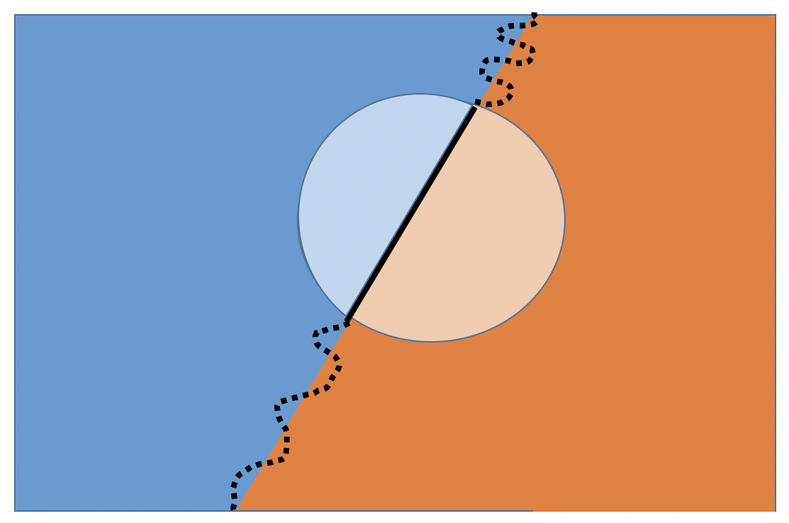

```{r setup, include=FALSE}
knitr::opts_chunk$set(echo = TRUE)
library(ggplot2)
knitr::opts_chunk$set(fig.align = "center")
library(ggplot2)
```

```{r xaringan-themer, include=FALSE, warning=FALSE}
library(xaringanthemer)
library(showtext)
library(knitr)
style_mono_light(base_color = "#003153", colors = c(
  orange = "#D73F09"),
  code_font_size = "0.75rem",
  code_inline_font_size = "0.75rem"
  )
```

# Lecture 1 {.unnumbered}

## Outline

- Review: Ratio Estimation
- Regression Estimation
  - Point Estimates
  - Bias, MSE, and Variance of Estimators
- Extended R Example: *Lohr* 4.8.11

---

## Review - Ratio Estimation

When we have auxiliary information, it may be preferable to use a *biased* but more precise estimator.

Want:

- $y_i$ and $x_i$ are obtained for every unit in the sample
- $\bar{x}_\mathcal{U}$ (or $t_x$) is also known
- Auxiliary variable $x$ and response $y$ highly correlated and relationship is **proportional** (linear, line passes through origin)

---

## Summary - Ratio Estimation

Assuming the data were collected via a SRS and it is appropriate to use a ratio estimator:

<br>

| | Point Estimate | Variance of Estimator
- | - | -
Ratio | $\hat{B}=\frac{\bar{y}}{\bar{x}}$ | $\hat{V}(\hat{B})=\left(1-\frac{n}{N}\right)\frac{s_e^2}{n\bar{x}^2}$
Mean | $\hat{\bar{y}}_r = \hat{B}\bar{x}_\mathcal{U}$ | $\hat{V}(\hat{\bar{y}}_r) = \left(1-\frac{n}{N}\right)\left(\frac{\bar{x}_\mathcal{U}}{\bar{x}}\right)^2\frac{s_e^2}{n}$
Total | $\hat{t}_{yr} = \hat{B}t_x$ | $\hat{V}(\hat{t}_{yr}) = \left(1-\frac{n}{N}\right)\left(\frac{t_x}{\bar{x}}\right)^2\frac{s_e^2}{n}$

<br>

where $s_e^2$ is the sample variance of the residuals $e_i$.

---

## Estimator Comparison

When will the ratio estimator have a smaller MSE than the simple inflation estimator (i.e., the naive, unbiased estimator)?

$$\begin{align*}
\text{MSE}(\hat{\bar{y}}_r) &\approx \left(1-\frac{n}{N}\right)\frac{1}{n}(S_y^2+B^2S_x^2-2BRS_yS_x) \\
\text{MSE}(\bar{y}) &= \left(1-\frac{n}{N}\right)\frac{1}{n}(S_y^2)
\end{align*}$$

So the ratio estimator $\hat{\bar{y}}_r$ will have smaller variance if

$$S_y^2 + B^2S_x^2 - 2BRS_yS_x < S_y^2$$

Simplify to get when

$$R>\frac{BS_x}{2S_y}=\frac{1}{2}\left(\frac{\frac{S_x}{\bar{x}}}{\frac{S_y}{\bar{y}}}\right)=\frac{CV(x)}{2CV(y)}$$

We can estimate this from the sample.

---

## Estimator Comparison

Determining which estimator of the population mean (or total, etc.) is better depends on:

- Correlation between $y$ and $x$
- CV's of the two variables

<br>

Note: If the two CV's are the same, the ratio estimate is better if $R>0.5$.

---

## Ratio Estimation

For a SRS, the "naive" estimator (the sample mean) was based solely on the *design* of the study.

<br>

The ratio estimator (and the regression estimator, next) make additional assumptions about the *model* between the response $y$ and some auxiliary variable $x$. Estimates can be poor if that model is wrong.

<br>

Ratio estimation works well when a straight line through the origin fits well and when the variance of the observations about the line is proportional to $x$.

---

## Ratio Estimation

What do we mean by *straight line through the origin fits well and when the variance of the observations about the line is proportional to $x$*?

```{r echo=FALSE, fig.width=5, fig.height=4, fig.align="center", out.width='500px', dpi=300, fig.alt="Plot with points along a line with positive slope passing through the origin. The spread of the points about the line increases for increasing values of x."}
x <- runif(50, min=0, max=20)
y <- 4*x + rnorm(50, mean=0, sd=x)
df <- data.frame(x, y)
m <- lm(y ~ x-1)

ggplot(df, aes(x=x, y=y)) + 
  theme_bw() + 
  geom_point(color="#43418A") +
  geom_abline(slope=m$coefficients, intercept=0, color="#D73F09")
```

---
class: center middle

# Regression Estimation

---

## Regression Estimation

In ratio estimation, we assumed $y_i\approx Bx_i$ ( $y$ and $x$ are linearly related and the line went through the origin).

<br>

If $x$ and $y$ are linearly related but the intercept is not 0, we can use **regression estimation**.

- As with ratio estimation, assume $x_i$ and $y_i$ are observed for every unit in the sample and $\bar{x}_\mathcal{U}$ (or $t_x$) is also known.
- When $x$ and $y$ are highly correlated, the regression line will provide a good fit.
- When $x$ and $y$ are not related in a LINEAR way, both ratio and regression estimation will provide poor estimates.

---

## Population Regression Line

Define the regression line $$y=B_0+B_1x$$

where the population slope and intercept are

$$\begin{align*}
B_1 &= \frac{\sum_{i=1}^N (x_i-\bar{x}_\mathcal{U})(y_i-\bar{y}_\mathcal{U})}{\sum_{i=1}^N(x_i-\bar{x}_\mathcal{U})^2} = \frac{RS_y}{S_x} \\
B_0 &= \bar{y}_U-B_1\bar{x}_\mathcal{U}
\end{align*}$$

<br>

$B_1$ and $B_0$ are the slope and intercept of the least squares line through the population scatterplot. $R$ is the population correlation coefficient of $x$ and $y$.

---

## Estimating the Slope and Intercept from the Sample

We can estimate $B_0$ and $B_1$ from sample data using the usual least squares formulas.

$$\begin{align*}
\hat{B}_1 &= \frac{\sum_{i\in\mathcal{S}}(x_i-\bar{x})(y_i-\bar{y})}{\sum_{i\in\mathcal{S}}(x_i-\bar{x})^2} = \frac{rs_y}{s_x}\\
\hat{B}_0 &= \bar{y}-\hat{B}_1\bar{x}
\end{align*}$$

where $r$ is the sample correlation coefficient of $x$ and $y$.

<br>

Then, analogously to the ratio estimator,

$$\hat{\bar{y}}_\text{reg}=\hat{B}_0+\hat{B}_1\bar{x}_\mathcal{U} = \bar{y}+\hat{B}_1(\bar{x}_\mathcal{U}-\bar{x})$$
Where $\bar{x}_\mathcal{U}$ is known.

---

## Regression Estimation

Like in ratio estimation, if $\bar{x}$ from the sample is smaller than the population mean $\bar{x}_\mathcal{U}$ and $x$ and $y$ are positively correlated, then we would expect $\bar{y}$ to be smaller than $\bar{y}_\mathcal{U}$. We would then want our estimate using regression estimation to be larger than $\bar{y}$. And vice versa.

<br>

The regression estimator adjusts $\bar{y}$ by adding the quantity $\frac{rs_y}{s_x}(\bar{x}_\mathcal{U}-\bar{x})$.

<br>

> What happens when $\bar{x}_\mathcal{U} < \bar{x}$?

---

## Bias of the Regression Estimator

Like the ratio estimator, the regression estimator is **biased**.

$$\begin{align*}
\text{Bias}(\hat{\bar{y}}_\text{reg})&=E[\hat{\bar{y}}_\text{reg}-\bar{y}_\mathcal{U}] \\
&= - \text{Cov}(\hat{B}_1, \bar{x})
\end{align*}$$

If the correlation between $x$ and $y$ in the population is $1$, the bias is $0$.

---

## MSE of the Regression Estimator

It can be shown that

$$\text{MSE}(\hat{\bar{y}}_\text{reg}) \approx \left(1-\frac{n}{N}\right)\frac{1}{n}S_y^2(1-R^2)$$

Thus, the approximate MSE is small when

- $n$ is large
- $n/N$ is large
- $S_y$ is small
- the correlation $R$ is close to $-1$ or $+1$

---

## Variance of the Regression Estimator

As with ratio estimation, assume $\text{Bias}(\hat{\bar{y}}_\text{reg})\approx 0$ (often true in large samples) so that

$$\begin{align*}
V(\hat{\bar{y}}_\text{reg}) &\approx \text{MSE}(\hat{\bar{y}}_\text{reg}) \\
&\approx V\left[\frac{1}{n}\sum_{i\in\mathcal{S}}(\underbrace{y_i-(B_0+B_1x_i}_{d_i}))\right]
\end{align*}$$

<br>

Where $d_i$ is the residual (vertical distance between point and line) from the regression model fit to the entire population.

---

## Residuals

$$d_i=y_i-(B_0+B_1x_i)$$

Approximate $d_i$ with

$$e_i=y_i-(\hat{B}_0+\hat{B}_1x_i)$$

Then the sample variance of the $e_i$ is

$$s_e^2=\frac{1}{n-1}\sum_{i\in\mathcal{S}}(e_i-\bar{e})^2=\frac{1}{n-1}\sum_{i\in\mathcal{S}}e_i^2$$

And the estimated variance of the regression estimator is

$$\hat{V}(\hat{\bar{y}}_\text{reg})=\left(1-\frac{n}{N}\right)\frac{s_e^2}{n}$$

---

## Standard Error

As we're used to, the standard error of the estimator is the square root of the variance:

$$\text{SE}(\hat{\bar{y}}_\text{reg})=\sqrt{\left(1-\frac{n}{N}\right)\frac{s_e^2}{n}}$$

---

## Summary (For Estimating Population Totals)

 | Estimator | Residual $e_i$ 
- | -
Naive | $\hat{t}_y$ | $y_i-\bar{y}$ 
Ratio | $\hat{t}_y\left(\frac{t_x}{\hat{t}_x}\right)$ | $y_i-\hat{B}x_i$ 
Regression | $N[\bar{y}+\hat{B}_1(\bar{x}_\mathcal{U}-\bar{x})]$ | $y_i-\hat{B}_0-\hat{B}_1x_i$

---
class: center middle

# Extended R Example

---

## Lohr 4.8.11

The data set `cherry.csv`, from Hand et al. (1994), contains measurements of diameter (inches), height (feet), and timber volume (cubic feet) for a sample of 31 black cherry trees. Diameter and height of trees are easily measured, but volume is more difficult to measure. Suppose that these trees are an SRS from a forest of $N = 2967$ trees and that the sum of the diameters for all trees in the forest is $t_x = 41,835$ inches.

```{r message=FALSE, warning=FALSE}
library(SDAResources)
data(cherry)

n <- 31
N <- 2967
tx <- 41835

# y is volume, x is diameter
cor(cherry$diameter, cherry$volume)
```

---

### Plot volume vs. diameter for the 31 trees

```{r fig.align="center", fig.alt="Plot of volume vs diameter for the 31 trees. The points closely follow a line with positive slope.", fig.height=3, fig.width=4, message=FALSE, warning=FALSE, dpi=300, out.width='400px'}
library(ggplot2)
ggplot(cherry, aes(x=diameter, y=volume)) + 
  geom_point(color="#43418A") + theme_bw() +
  ggtitle("Cherry Trees")
```

---

## Task

Estimate the **total volume** for all trees in the forest using

1. Naive estimation (no auxiliary variable)
2. Ratio estimation using diameter as auxiliary variable
3. Regression estimation using diameter as auxiliary variable

---

## Naive estimation (no auxiliary variable)

```{r}
ty.naive <- mean(cherry$volume) * N
v.naive <- N^2 * (1-n/N) * var(cherry$volume) / n

ty.naive
sqrt(v.naive)
```

---

## Ratio estimation setup

```{r}
mean(cherry$diameter)
tx/N
```

<br>

The sample mean diameter is smaller than the population mean diameter, so we might expect the sample volume to be too small as well (as an estimate of the population volume). 

<br>

Ratio/regression estimators will increase sample the mean.

---

## Ratio estimation

```{r}
# point estimate
B.hat <- mean(cherry$volume) / mean(cherry$diameter)
ty.rat <- B.hat * tx

# residuals, variance of residuals, and variance of estimator
ei.rat <- cherry$volume - B.hat*cherry$diameter
se2.rat <- sum(ei.rat^2)/(n-1)
v.rat <- (1-n/N) * (tx/mean(cherry$diameter))^2 * se2.rat/n

ty.rat
sqrt(v.rat)
```

---

### Let's plot the ratio line

```{r fig.width=4, fig.height=3, fig.align="center", out.width='400px', dpi=300, fig.alt="Plot of volume vs diameter for the 31 trees. This plot builds on the previous one. In addition to the points which closely follow a line with positive slope, there is a line superimposed which also has positive slope but the slope is a little shallower than the natural line through the points."}
ggplot(cherry, aes(x=diameter, y=volume)) + 
  geom_point(color="#43418A") + theme_bw() +
  ggtitle("Cherry Trees") +
  lims(x=c(0,25), y=c(0,80)) +
  geom_abline(slope=B.hat, intercept=0, color="red")
```

---

## Regression estimation - estimation of slope and intercept

```{r}
B1.hat <- sum((cherry$diameter - mean(cherry$diameter)) * 
                (cherry$volume - mean(cherry$volume))) / 
                sum((cherry$diameter - mean(cherry$diameter))^2)
B1.hat

# can see an equivalent way of calculating B1.hat
cor(cherry$diameter, cherry$volume) * sd(cherry$volume) / 
  sd(cherry$diameter)

B0.hat <- mean(cherry$volume) - B1.hat*mean(cherry$diameter)
B0.hat
```

---

## Regression estimation - estimation of slope and intercept

```{r}
# can see that these are the regression coefficients we get using lm
lm(volume ~ diameter, data=cherry)
```

---

## Regression estimation

```{r}
# point estimate
ty.reg <- N * (B0.hat+B1.hat*tx/N)
ty.reg

# residuals, variance of residuals, and variance of estimator
ei.reg <- cherry$volume - (B0.hat+B1.hat*cherry$diameter)
se2.reg <- sum(ei.reg^2)/(n-1)
v.reg <- N^2 * (1-n/N) * se2.reg/n

sqrt(v.reg)
```

---

### Let's plot the regression line

```{r fig.width=4, fig.height=3, fig.align="center", out.width='400px', dpi=300, fig.alt="Plot of volume vs diameter for the 31 trees. This plot builds on the previous one. In addition to the points which closely follow a line with positive slope, and the ratio line, there is a line superimposed which also has positive slope and which closely follows the trend of the points. The slope of the regression line is steeper than that of the ratio line."}
ggplot(cherry, aes(x=diameter, y=volume)) + 
  geom_point(color="#43418A") + theme_bw() +
  ggtitle("Cherry Trees") +
  lims(x=c(0,25), y=c(0,80)) +
  geom_abline(slope=B.hat, intercept=0, color="red") + 
  geom_abline(slope=B1.hat, intercept=B0.hat, color="blue")
```

---

## Estimator comparison

```{r, echo=FALSE}
output <- matrix(c(ty.naive, ty.rat, ty.reg, v.naive, v.rat, v.reg), ncol=2, byrow=FALSE)
colnames(output) <- c("Estimate of total", "Variance of estimator")
row.names(output) <- c("Naive", "Ratio", "Regression")

kable(output)
```

# Lecture 2 {.unnumbered}

## Outline

- **Estimation in Domains** (Section 4.2)
  - Introduction/Motivation
  - Estimator of Population Mean and its Variance and Standard Error  
  - Example
  - Estimator of Population Total and its Variance and Standard Error
- **Poststratification** (Section 4.4)
  - Reasons to Poststratify
  - Point Estimates
  - Variances

# Estimation in Domains

## Motivation

- We may want separate estimates for sub-populations after conducting a survey. 

*Example*: You selected a simple random sample (SRS) of 500 students from OSU’s roster of 10,000 students to estimate the average GPA of all students. You are also interested in estimating the average GPA of students who own a car.

---

## Domains

A **domain** is a sub-population. Domains are like strata except they do not need to *partition* the population, and we do not know which units are in which domains in advance. (e.g., You don't know which OSU students from the roster have cars.)

<br>

*Why treat this differently?*

The number of units in a domain is not known until they are sampled, so this number too is a random variable.

---

## Visual representation of a domain

:::: {.columns}
::: {.column width="40%"}

:::

::: {.column width="60%"}
Here, the rectangle represents the population, and the circle represents a sample drawn from it. A squiggly line divides the population into two domains, reflecting the uncertainty about individual units’ domain membership in the population. In contrast, a straight line separates the two domains within the sample, indicating that each sampled unit’s domain membership is known.
:::
::::
---

## Notation

- $\mathcal{U}_d$: index set of units in the population in domain $d$ 
- $N_d$: number of population units in $\mathcal{U}_d$
- $\mathcal{S}_d$: index set of sampled units in domain $d$ 
- $n_d$: number of sampled units in domain $d$
- $\bar{y}_{\mathcal{U}_d}$: population mean in domain $d$
- $\bar{y}_d$: sample mean in domain $d$

## Estimation in Domains

Goal is to get *domain-specific* estimates.

<br>

The population mean in domain $d$ is $$\bar{y}_{\mathcal{U}_d}=\frac{\sum_{i\in\mathcal{U}_d}y_i}{N_d}$$

We can estimate $\bar{y}_{\mathcal{U}_d}$ using the sample mean in domain $d$, 

$$\bar{y}_d=\frac{\sum_{i\in\mathcal{S}_d}y_i}{n_d}$$

<br>

Note: $n_d$ is a **random variable**.

---

## Some More Examples

Example 1: Population is stream segments. Domain is segments with beaver activity.

<br>

Example 2: Population is households. Domain is households with more than 4 people.

---

## Ratio Estimation for Estimation in Domains

Estimation in domains is a special application of ratio estimation, but the goal is not to reduce variance.

<br>

When we observe unit $i$ in the sample, we take the measurement $y_i$ and the auxiliary variable $x_i$ is

$$x_i=\begin{cases}1 & \text{unit }i\text{ in domain} \\ 0 & \text{otherwise}\end{cases}$$

---

## Example

unit | $y$ = \#fish | $x$ = indicator of beavers | $u=y\cdot x$ 
:-: | :-: | :-: | :-:
1 | $y_1$ | 1 | $y_1$ 
2 | $y_2$ | 0 | 0 
$\vdots$ | $\vdots$ | $\vdots$ | $\vdots$ 
N | $y_N$ | 1 | $y_N$

<br>

$$u_i=\begin{cases}y_i & \text{unit }i\text{ in domain} \\ 0 & \text{otherwise}\end{cases}$$

<br>

The total number of fish in the domain is $t_u=\sum_{i=1}^N u_i$.

The total number of population units in the domain is $t_x=\sum_{i=1}^N x_i$.

---

## Point Estimate for Domains

The population mean in the domain is $\frac{t_u}{t_x}=B$, the population ratio.

<br>

Can use ratio estimation to estimate the mean in the domain:

$$\hat{B}=\frac{\text{sample mean of }u\text{'s}}{\text{sample mean of }x\text{'s}}=\frac{\bar{u}}{\bar{x}}=\frac{\frac{\sum_{i\in\mathcal{S}_d}y_i}{n}}{\frac{n_d}{n}}=\bar{y}_d$$

<br>

So the point estimate of the population mean in the domain is the sample mean in the domain.

<br>

This is similar to estimating the population mean in a stratum, except we do not know in advance which units fall in the domain.

---

## Variance of the Estimator

Because we're estimating a ratio, need to use the ratio variance formula:

$$\begin{align*}
\hat{V}(\bar{y}_d) &= \left(1-\frac{n}{N}\right)\frac{1}{n\bar{x}^2}\frac{\sum_{i\in\mathcal{S}}(u_i-\hat{B}x_i)^2}{n-1} \\
&= \ldots \\
&=\left(1-\frac{n}{N}\right)\frac{n}{n_d^2}\frac{(n_d-1)s_{yd}^2}{n-1} \\
\end{align*}$$

where $$s_{yd}^2=\frac{\sum_{i\in\mathcal{S}_d}(y_i-\bar{y}_d)^2}{n_d-1}$$ is the sample variance of observations in domain $d$.

---

## Simplified Variance of the Estimator

$$\begin{align*}
\hat{V}(\bar{y}_d) &=\left(1-\frac{n}{N}\right)\frac{n}{n_d^2}\frac{(n_d-1)s_{yd}^2}{n-1} \\
&\approx \left(1-\frac{n}{N}\right)\frac{s_{yd}^2}{n_d}
\end{align*}$$

for $n$, $E(n_d)$ large. 

---

## Example

A study is proposed to figure out the average amount of money OSU students who own cars spend on gas each month. We have a complete list of students we can draw a SRS from, but we don't know which students own cars. There are 30,592 total students, and we draw a SRS of 500.

---

## Example Sample Data

Student | $y=$ Amount Spent on Gas | $x=$ Own Car  | $u=yx$
:-: | :-: | :-: | :-:
1 | 100 | 1 | 100
2 | 0 | 0  | 0
3 | 5 | 0 | 0
$\vdots$ | $\vdots$ | $\vdots$ | $\vdots$
500 | 200 | 1 | 200

<br>

In the sample, 

- $\bar{x}=0.75$
- $\bar{u}=90$
- $n_d=n\bar{x}=500(0.75)=375$
- $s_{yd}^2=5408$

---

## Example

> Estimate the average amount of money OSU students who own cars spend on gas.

$$\begin{align*}
\bar{y}_d &= \hat{B} = \frac{\bar{u}}{\bar{x}} = \frac{90}{0.75} = 120 \\
\hat{V}(\bar{y}_d) &= \left(1-\frac{n}{N}\right)\frac{n}{n_d^2}\frac{(n_d-1)s_{yd}^2}{n-1} \\
&= \left(1-\frac{500}{30592}\right)\frac{500}{375^2}\frac{(375-1)(5408)}{500-1} \\
&= 14.39
\end{align*}$$

<br>

Note: because $\frac{n}{N}$ is small, $n$ is large, and $E(n_d)$ is large, we could approximate the variance using $\frac{s_{yd}^2}{n_d}=\frac{5408}{375}=14.42$

---

## Estimation in Domains - Totals

If $N_d$ is known, estimate $\hat{t}_{yd} = N_d\bar{y}_d$ and $\hat{V}(\hat{t}_{yd})=N_d^2\hat{V}(\bar{y}_d)$.

<br>

If $N_d$ not known,

$$\begin{align*}
\hat{t}_{yd} &= \hat{t}_u = N\bar{u} \\
\hat{V}(\hat{t}_{yd}) &= N^2\left(1-\frac{n}{N}\right) \frac{s_{u}^2}{n} \\
\end{align*}$$

where $s_u^2$ is the variance of $u$.

<br>

Recall: $u_i=y_ix_i=\begin{cases}y_i&\text{if }i\text{ in domain} \\ 0 & \text{otherwise}\end{cases}$

---

## Example

Draw a sample of size 4 from 1000 streams. 

> Estimate the total number of fish in streams with beavers.

#### Data:

Stream | $y$ = \#fish | $x$ = indicator of beavers | $u=y\cdot x$
:-: | :-: | :-: | :-:
1 | 40 | 1 | 40
2 | 60 | 0 | 0
3 | 20 | 1 | 20
4 | 50 | 0 | 0

---

## Example

Draw a sample of size 4 from 1000 streams. 

> Estimate the total number of fish in streams with beavers.

$$\begin{align*}
\hat{t}_{yd} &= \hat{t}_u = N\bar{u} = 1000(15) = 15,000 \\
s_u^2 &= \frac{(40-15)^2+(0-15)^2+(20-15)^2+(0-15)^2}{4-1}\\
&= 366.6667 \\
\hat{V}(\hat{t}_{yd}) &= N^2\left(1-\frac{n}{N}\right) \frac{s_u^2}{n} \\
&= 1000^2 \left(1-\frac{4}{1000}\right) \frac{366.6667}{4} \\
&= 91300008
\end{align*}$$

So the standard error is $\sqrt{91300008}=9555.104$.

---
class: middle center

# Poststratification

---

## Poststratification

Combine several ideas we've been talking about!

<br>

Population is partitioned into **poststrata**. These are domains where (as we've been talking about) we don't know which units are in which poststrata before we draw the sample.

<br>

Like stratified sampling, we are interested in an estimate for the whole population, not just in a single poststrata (like we've been talking about for domains).

---

## Poststratification

Poststratification is used a lot.

<br>

Stratification is good, but you need to make sure the stratification variable does partition the population into homogeneous strata, and you need that information *before* collecting data.

<br>

Given a SRS, you can decide to poststratify *later* if you have collected poststratification information.

---

## Reasons to Poststratify

1. Same reason as stratification -- to reduce variance of estimators.
1. Correct for bad samples (i.e., some poststrata are underrepresented in the sample). Need to assume poststrata are homogeneous.
1. Adjust for different non-response rates in different strata (more later).

---

## Design vs. Estimators

It is important to distinguish between sampling design and estimators:

- Design: SRS, stratified sampling
- Estimator: "naive", ratio, regression, poststratification

---

## Poststratification

Suppose you want to stratify and you know $N_h$ for all strata, but not the stratum membership of each unit.

<br>

For a SRS with large enough $n$, the sample is likely to resemble a stratified sample with proportional allocation.

<br>

Consider the strata to be domains. The sample domain sizes $n_1, n_2, \ldots, n_H$ are random quantities, where $H$ is the number of domains.

---

## Example

Suppose we want to estimate average textbook cost for OSU students. We are going to poststratify by College because we suspect different Colleges will have different textbook costs, but we don't know which College a student is in ahead of time.

<br>

Student | $y=\text{cost}$ | $x_1=\begin{cases}1&\text{student in Ag} \\ 0 & \text{otherwise}\end{cases}$ | $x_2=\begin{cases}1&\text{student in Eng} \\ 0 & \text{otherwise}\end{cases}$
:-: | :-: | :-: | :-:
1 | 200 | 1 | 0
2 | 400 | 0 | 1
$\vdots$ | $\vdots$ | $\vdots$ | $\vdots$
N | 250 | 1 | 0

---

## Poststratification

We use the ratio estimation framework:

$$\begin{align*}x_{ih}&=\begin{cases} 1 & \text{if observation }i\text{ in poststratum }h \\ 0 & \text{otherwise}\end{cases} \\
u_{ih} &= y_ix_{ih} \\
t_{xh} &= \sum_{i=1}^N x_{ih} = N_h \\
t_{uh} &= \sum_{i=1}^N u_{ih} = \text{population total of variable }y\text{ in poststratum } h
\end{align*}$$

---

## Poststratification

We can estimate these poststratum totals from the sample:

$$\begin{align*}
\hat{t}_{uh} &= \sum_{i\in\mathcal{S}} \frac{N}{n} u_{ih} = N \bar{u}_h
\end{align*}$$

<br>

(This is the domain total estimator with unknown stratum sizes we talked about earlier.)

---

## Estimating Totals

We can then include auxiliary information about the poststratum size in the ratio estimator:

$$\begin{align*}
\hat{t}_{uhr} &= \frac{t_{xh}}{\hat{t}_{xh}}\hat{t}_{uh} = \frac{N_h}{\hat{N}_h}\hat{t}_{uh}=N_h\bar{y}_h
\end{align*}$$

And sum over all poststrata to get $$\hat{t}_{y\text{post}}=\sum_{h=1}^H \hat{t}_{uhr}=\sum_{h=1}^H N_h\bar{y}_h$$

---

## Estimating Means

Similarly,

$$\begin{align*}
\bar{y}_h &= \frac{1}{n_h}\sum_{i\in\mathcal{S}_h}y_i = \frac{\frac{1}{n}\sum_{i\in\mathcal{S}}u_{ih}}{\frac{1}{n}\sum_{i\in\mathcal{S}}x_{ih}} \\
\bar{y}_\text{post} &= \sum_{h=1}^H \frac{N_h}{N}\bar{y}_h \\
\end{align*}$$

---

## Poststratification

$$\bar{y}_\text{post} = \sum_{h=1}^H \frac{N_h}{N}\bar{y}_h$$

This looks just like our estimator for a mean using stratified sampling except here the $n_h$ are random ( $n_h$ are used to calculate $\bar{y}_h$ ). They depend on the particular sample drawn. This randomness adds to the variance of the poststratified estimator.

---

## Comparison with Stratified Sampling

If $n$ large, $E(n_h)$ large, then in a SRS $\frac{n_h}{n}\approx\frac{N_h}{N}$. This is like stratified sampling with proportional allocation.

<br>

Recall:

$$\begin{align*}
V(\bar{y}_\text{str})&=\sum_{h=1}^H\left(1-\frac{n_h}{N_h}\right)\left(\frac{N_h}{N}\right)^2\frac{S_h^2}{n_h} \\
&= \left(1-\frac{n}{N}\right)\sum_{h=1}^H\frac{N_h}{N}\frac{S_h^2}{n}
\end{align*}$$

assuming proportional allocation.

---

## Poststratification Variances

$$\begin{align*}
V(\bar{y}_\text{post}) &= \left(1-\frac{n}{N}\right)\sum_{h=1}^H\frac{N_h}{N}\frac{S_h^2}{n} + \text{extra variation from random }n_h \\
\hat{V}(\bar{y}_\text{post}) &\approx \left(1-\frac{n}{N}\right)\sum_{h=1}^H\frac{N_h}{N}\frac{s_h^2}{n}
\end{align*}$$

<br>

when $n$, $E(n_h)$ large.

---

## Poststratification

Note: It seems like we need to know $N_h$. This may not be the case since we don't know in advance how to stratify. We really only need to know $\frac{N_h}{N}$ (proportion in strata), which may be slightly easier to approximate.